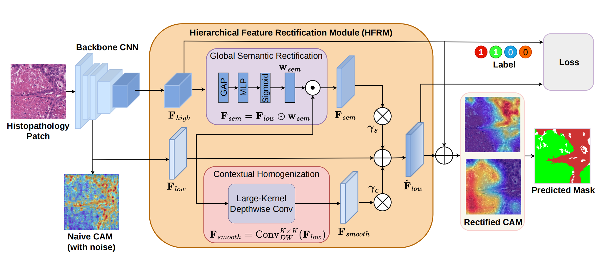
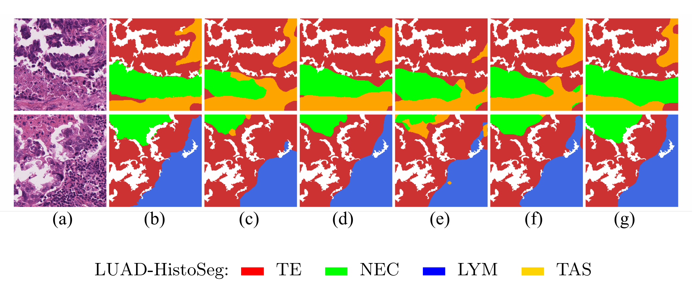

+++
date = '2026-11-08T04:00:00+08:00'
draft = false
title = '论文阅读：SSHR——单阶段分层矫正的弱监督病理组织分割'
summary = 'MICCAI 2026 Single-Stage Hierarchical Rectification for Weakly Supervised Histopathology Segmentation 阅读笔记：HFRM 模块如何在前向传播中净化 CAM，让单阶段方法超越多阶段流水线。'
tags = ['论文阅读', '弱监督分割', '病理图像分析', 'MICCAI 2026', '论文复现']
categories = ['论文阅读']
cover = '/images/fm4.png'
+++

> 单阶段分层矫正的弱监督病理组织分割（SSHR）| MICCAI 2026
>
> - 原文链接：<https://arxiv.org/abs/2606.20250>
> - 原文下载：<https://papers.miccai.org/miccai-2026/paper/3170_paper.pdf>
> - 官方代码：SSHR-main（开源仓库，见论文主页）

## 一、研究背景与动机（Motivation）

现有的计算病理学弱监督语义分割（WSSS）采用**多阶段**方法：

1. **第一阶段**：训练分类网络生成类激活图（CAM）伪掩码；
2. **第二阶段**：离线（即脱离前后阶段独立进行）精炼伪掩码，比如用条件随机场 CRF 或 AffinityNet；
3. **第三阶段**：利用精炼后的伪掩码，训练最终的分割网络。

**缺点：**

1. **训练成本高**：生成、精修、分割网络需要分别训练三次，对于动辄千兆像素的病理切片来说，计算瓶颈严重。
2. **误差固化与传播**：第一阶段生成的 CAM 存在假阳性（模型把背景或正常组织错误高亮成了肿瘤）和噪点。第二阶段的离线精修大多只关注局部边缘，洗不干净那些大块的假阳性，因此错误被固化。在第三阶段重训时，分割网络把噪点当成了真理去拟合，导致错误被放大。

> **补充：什么是 CAM？**
>
> Class Activation Map（类激活图）是通过对分类网络的深层特征图进行全局平均池化（GAP）和全连接层加权计算得出的热力图。它高亮了模型在做图像级分类（比如判断"是不是肿瘤"）时最关注的局部区域。但 CAM 通常只覆盖目标判别性最强的部位（如肿瘤的某一块），且边缘模糊、带有噪声。

## 二、核心创新：SSHR 框架

为了解决上述问题，作者提出**单阶段分层矫正（SSHR）**框架：在产生 CAM 阶段就想办法抑制局部异常，引入**分层特征矫正模块（HFRM）**，利用深层全局语义上下文来引导产生 CAM 的浅层和中间层特征。深层网络的特征粗糙但感受野大，看的是"全局形态"，以此指导浅层的特征，抑制浅层特征的局部异常，经过一次传播就能得到干净的 CAM。


*图1：SSHR 框架总览图*

### 框架图解读

**1. 输入与特征提取（左侧部分）**

- **Histopathology Patch**：输入的病理组织学图像。
- **Backbone CNN**：主干卷积神经网络（如 ResNet）。它将图像提取为不同层级的特征：
  - $F_{high}$（深层特征）：感受野大，分辨率低。它拥有"大局观"（全局语义上下文），知道画面里整体是什么（比如整体看起来像肿瘤），但看不清局部细节。
  - $F_{low}$（浅层特征）：感受野小，分辨率高。它包含"局部细节"（纹理、边缘），但很容易被局部的相似颜色或纹理欺骗，产生假阳性（局部异常激活）。
- **Naive CAM (with noise)**：用最传统方法直接算出来的初始 CAM。左侧底部的热力图非常嘈杂，有很多红黄色的散乱噪点，即前面提到的假阳性区域。

**2. 核心创新：分层特征矫正模块（HFRM，中间橙色区域）**

这个模块是整张图的核心，包含两个并行的子模块，专门用来"提纯"特征：

- **全局语义矫正（Global Semantic Rectification，上半部分）**
  - **操作**：将深层的 $F_{high}$ 经过 GAP（全局平均池化，提取全局信息）→ MLP（多层感知机学习权重，在本次实验中它将深层特征向量 $v_g$ 的长度压缩，后续再延长回来）→ Sigmoid（激活函数，将输出限制在 0 到 1 之间，代表数值的权重），得到权重向量 $w_{sem}$。将权重 $w_{sem}$ 与浅层特征 $F_{low}$ 相乘（$\odot$），得到 $F_{sem}$。（哈达玛积：$F_{low}$ 是三维张量，$w_{sem}$ 是一维向量，代码实现时会把向量里的每一个值，去乘对应通道里的所有像素点。）
  - **作用**：这就是"利用深层全局语义上下文引导浅层特征"。用深层的"大局观"去审视浅层特征，调低那些"局部看起来像、但全局语义说不通"的假阳性像素的权重，将其压制下去。
- **上下文同质化（Contextual Homogenization，下半部分）**
  - **操作**：将浅层特征 $F_{low}$ 送入 Large-Kernel Depthwise Conv（大核深度卷积），得到平滑后的特征 $F_{smooth}$。
  - **作用**：大卷积核可以扩大感受野，起到"平滑"的作用。它把局部细碎、杂乱的异常高频噪声抹平，让物体内部的特征更加一致（同质化），减少 CAM 上的噪点。

**3. 特征融合与输出（右侧部分）**

- **残差连接**：原始的浅层特征 $F_{low}$ 加上矫正后的语义特征 $F_{sem}$（乘以可学习缩放系数 $\gamma_s$），再加上平滑特征 $F_{smooth}$（乘以系数 $\gamma_c$）。
- $\hat{F}_{low}$：经过彻底"洗涤"和矫正后的高质量浅层特征。
- **Rectified CAM**：基于融合后的特征生成的新 CAM。相比左下角的 Naive CAM，矫正后的热力图非常干净，边界清晰，假阳性噪点被大幅消除。
- **Predicted Mask**：最终输出的分割掩码。
- **Label & Loss**：网络依然使用图像级别的标签（比如"这是肿瘤切片"或"正常切片"）来计算分类损失（Loss），进行端到端的单阶段训练。

## 三、核心模块与公式拆解（Methodology）

HFRM 由两个互补分支组成：**全局语义矫正（GSR）**和**上下文同质化（CH）**。

### 1. 全局语义矫正（GSR）

旨在平衡局部组织细节与图像级语义上下文。在病理学中，组织结构表现出显著的形态异质性：浅层和中间层特征保留了精细的边界和局部纹理，但有限的感受野使其容易产生纹理驱动的假阳性；相反，深层特征提供更强的图像级语义上下文，但空间上较粗糙。GSR 通过使用深层语义上下文引导产生 CAM 的中间表示来弥合这一差距。

设 $F_{low} \in \mathbb{R}^{C \times H \times W}$ 为产生 CAM 的浅层特征图，它有 $C$ 个通道，空间分辨率高（$H \times W$）；$F_{high} \in \mathbb{R}^{D \times h \times w}$ 为深层特征图，分辨率低（$h \times w$），但通道数多（$D$）。如何把深层特征变成能去指导浅层特征的权重呢？这里用到了经典的通道注意力机制：

$$
w_{sem} = \sigma\big(\mathbf{W}_2 \, \delta(\mathbf{W}_1 v_g)\big) \tag{1}
$$

在式（1）中，首先对 $F_{high}$ 应用全局平均池化（GAP），把空间维度（$h \times w$）压扁，得到一个长度为 $D$ 的全局上下文一维向量 $v_g$。  
该向量通过轻量多层感知机（MLP）和 Sigmoid 激活映射，生成一个长度为 $C$ 的通道注意力向量 $w_{sem}$。式中 $\mathbf{W}_1$ 负责降维，$\mathbf{W}_2$ 负责升维；$\delta$ 是 ReLU 激活函数，负责过滤负值并增加非线性；$\sigma$ 是 Sigmoid，把数值压到 0~1 代表权重。

语义矫正后的特征通过通道维度的哈达玛积计算：

$$
F_{sem} = F_{low} \odot w_{sem} \tag{2}
$$

这里 $\odot$ 表示哈达玛积（Hadamard product），也就是逐通道相乘。$F_{low} \in \mathbb{R}^{C \times H \times W}$，$w_{sem} \in \mathbb{R}^{C}$，在代码实现中，就是把向量里的每一个值，去乘对应通道里的所有像素点（$H \times W$ 个），最终得到干净的特征图。

> **补充：三个基础组件**
>
> - **MLP（Multi-Layer Perceptron，多层感知机）**：由多层全连接层组成，用来学习特征之间的复杂关系。如果只用一层，只能学到线性关系；用了多层，就能学到非线性的、更复杂的逻辑。公式中先通过 $\mathbf{W}_1$ 把深层特征向量 $v_g$ 的长度从 $D$ 压缩到 $D/S$（比如缩小 16 倍），这能大幅减少参数量，还能让网络提取最精华的语义信息；再通过 $\mathbf{W}_2$ 把长度恢复回 $C$（浅层特征的通道数）。MLP 负责"分析"全局上下文，计算出浅层各个通道应该保留的比例。
> - **ReLU（Rectified Linear Unit，修正线性单元）**：神经网络里最常用的激活函数，$f(x) = \max(0, x)$。在公式中负责给计算过程注入非线性能力（通过非线性变换，网络能拟合各种复杂的曲线），过滤掉负的激活值。
> - **Sigmoid**：另一个常用激活函数，$f(x) = \frac{1}{1 + e^{-x}}$。不管输入的数值是多少，它的输出都会被"挤压"在 0 到 1 之间。Sigmoid 把 MLP 计算出的任意数值，转化成了 0~1 之间的概率值（$w_{sem}$）：如果输出接近 1，代表这个通道非常重要，全局语义确认它是肿瘤特征；如果输出接近 0，代表这个通道很可能是噪声或假阳性。

### 2. 上下文同质化（CH）

使用大核深度卷积（Depthwise Conv）进行上下文同质化，解决局部孤立的空间噪点。

给定 $K \times K$ 大小的空间核，计算空间平滑特征 $F_{smooth}$：

$$
F_{smooth} = \mathrm{Conv}^{K \times K}_{DW}(F_{low}) \tag{3}
$$

即每个像素和它周围 $K \times K$ 邻域的特征做平均，DW：Depthwise（逐通道/深度卷积）。

为将这些矫正整合到骨干网络中而不引起突然的优化变化，使用零初始化残差连接来构建最终矫正特征 $\hat{F}_{low}$：

$$
\hat{F}_{low} = F_{low} + \gamma_s F_{sem} + \gamma_c F_{smooth} \tag{4}
$$

其中 $\gamma_s$ 和 $\gamma_c$ 是**零初始化的可学习标量参数**。一开始 $\gamma_s$ 和 $\gamma_c$ 都为 0，网络完全等价于原始骨干网络；随后网络再根据损失函数 Loss 逐渐学习 $\gamma$ 的值，决定需要融入多少矫正信息。这种设计能防止刚开始加入模块时破坏预训练权重，稳定训练过程。

### 3. 多尺度 CAM 生成与损失函数

在网络提取了不同层级的特征（$s = 1$ 到 $S$ 个尺度）之后，对不同层级的特征分别做 $1 \times 1$ 卷积，卷积核的尺寸是 $C \times 1 \times 1$，$C$ 为 $\hat{F}_{low}$ 的通道数（$\hat{F}_{low} \in \mathbb{R}^{C \times H_s \times W_s}$）。假设我们将图上的信息做 3 分类（背景、肿瘤、间质，$N_c = 3$），那么每个类都有一个卷积核。使用其中一个核进行卷积，把不同通道上相同位置的数值相加，得到一个总分，即是该像素点是否属于该类的得分。依照这个流程生成每个尺度的类激活图 $M_s$，此时其大小为 $N_c \times H_s \times W_s$。

利用某一次训练得到的 $\hat{F}_{low}$ 计算出 $M_s$，就可以进一步反向训练 $\gamma$ 的值，关键在于多尺度二元交叉熵损失函数：

$$
L_{cls} = \frac{1}{S} \sum_{s=1}^{S} \left( -\frac{1}{N_c} \sum_{k=1}^{N_c} \Big[ y_k \log\big(\sigma(p_{s,k})\big) + (1 - y_k) \log\big(1 - \sigma(p_{s,k})\big) \Big] \right) \tag{5}
$$

其核心为**二元交叉熵**（BCE）公式，用来衡量"预测概率"和"真实标签"之间的差距：

在 $-\Big[ y_k \log\big(\sigma(p_{s,k})\big) + (1 - y_k) \log\big(1 - \sigma(p_{s,k})\big) \Big]$ 中，
- $y_k \in \{0, 1\}$：真实标签（Ground Truth），$y_k = 1$ 表示图里有第 $k$ 类组织（比如肿瘤），$y_k = 0$ 表示没有；
- $p_{s,k}$：网络在第 $s$ 个尺度上，对第 $k$ 类输出的原始预测值（Logits）。假设第 $k$ 类为肿瘤，$p_{s,k}$ 就是在肿瘤对应卷积核生成的类激活图的第 $s$ 个尺度上，对这 $H_s \times W_s$ 个数值求平均；
- $\sigma(\cdot)$：Sigmoid 函数，把 $p_{s,k}$ 压缩到 0~1 之间，变成概率值。

如果真实有（$y_k = 1$），公式后半部分为 0，只剩下 $-\log(\text{预测概率})$：预测概率越接近 1，损失越小；越接近 0，损失越大（惩罚）。  
如果真实没有（$y_k = 0$），公式前半部分为 0，只剩下 $-\log(1 - \text{预测概率})$：预测概率越接近 0，损失越小；越接近 1，损失越大（惩罚）。  
$N_c$ 为组织的类别数量，因为这个任务是**多标签分类**（Multi-label，一张图里可能同时存在多种组织），所以要把这 $N_c$ 个类别的 BCE 损失全部加起来，然后除以 $N_c$ 计算平均值。

对每个组织标签的二元交叉熵取平均后，再对每张特征图（浅层、中层、深层特征图）取平均，得到多尺度二元交叉熵损失函数。在传统方法中，通常只拿最深层特征算一次 Loss；但这篇论文希望浅层特征也能生成高质量的 CAM，因此**对 HFRM 矫正过的多个层级的特征都进行监督**。

### 4. 最终 CAM 融合

上面训练出了每个尺度的类激活图 $M_s$，但这 $S$ 个尺度上的分辨率并非都相等，其数值范围也可能有很大差异（比如深层的 CAM 数值都在 100~200 之间，浅层的在 800~900 之间），因此要进行最终 CAM 融合：

$$
M_{final} = \sum_{s=1}^{S} \alpha_s \cdot \mathrm{Norm}\big(\mathrm{Up}(M_s)\big) \tag{6}
$$

对不同尺度的 CAM 进行**上采样**（把不同尺度（分辨率）的特征图变成统一尺寸）并**归一化**（缩放到同一个标准范围，比如 0~1 之间），再进行**加权平均**（训练不同的权重，代表希望生成激活图的侧重方向不同，比如希望细节更突出或者定位更准），可以得到最终高分辨率激活图。

## 四、实验与结果（Experiments）

### 1. 数据集与评价指标

- **数据集**：**LUAD-HistoSeg**：54 位肺腺癌患者的全切片图像；**BCSS**：151 名患者的乳腺癌全切片图像，包含肿瘤、间质、坏死、淋巴细胞等类别。
- **指标**：
  - **mIoU（平均交并比）**：预测区域和真实区域的"重叠面积"除以"并集总面积"，对边界贴合度要求高。
  - **mDice（平均戴斯系数）**：分子是"重叠面积的两倍"，分母是"各自面积相加"。因为医学图像里肿瘤可能很小，Dice 对微小目标更敏感，更被医学界广泛使用。由于公式不同，通常同一结果 Dice 的数值会略高于 IoU。

### 2. 对比实验

**表 1. 与最先进方法在 LUAD-HistoSeg 和 BCSS 上的比较。** Phase 1 指初始 CAM/掩码，Phase 2 指重训后的最终分割结果。结果以均值 ± 标准差报告。\* 表示与其他方法相比具有统计显著性（$p < 0.05$，双尾 t 检验）。最佳结果加粗。

**LUAD-HistoSeg：**

| 方法 | 会议 | 骨干网络（P1 / P2） | mIoU P1 (%) | mIoU P2 (%) | mDice P1 (%) | mDice P2 (%) |
|:---|:---|:---|:---:|:---:|:---:|:---:|
| MLPS | MIA'22 | ResNet38 / ResNet101 | 74.18 ± 0.89 | 75.27 ± 0.13 | 85.42 ± 0.73 | 85.82 ± 0.08 |
| ARML | MICCAI'24 | ResNet38 / ResNet101 | 73.44 ± 0.27 | 76.55 ± 0.07 | 84.65 ± 0.18 | 86.67 ± 0.04 |
| ESFAN | MICCAI'25 | ResNet38 / ResNet200 | 75.76 ± 0.33 | 76.83 ± 0.38 | 86.17 ± 0.22 | 86.86 ± 0.24 |
| PBIP | CVPR'25 | MiT-B1 / ResNet200 | 74.46 ± 0.51 | 75.89 ± 0.26 | 85.62 ± 0.22 | 86.02 ± 0.13 |
| WAWEHIS | TMI'25 | ResNet38 / ResNet200 | 72.62 ± 0.31 | 74.69 ± 0.52 | 84.10 ± 0.21 | 85.46 ± 0.32 |
| DuPL | CVPR'24 | ViT-B | – | 63.71 ± 0.11 | – | 73.06 ± 0.21 |
| **SSHR（本文）** | – | ResNet38 | – | **77.93 ± 0.24\*** | – | **87.54 ± 0.19\*** |

**BCSS：**

| 方法 | 会议 | 骨干网络（P1 / P2） | mIoU P1 (%) | mIoU P2 (%) | mDice P1 (%) | mDice P2 (%) |
|:---|:---|:---|:---:|:---:|:---:|:---:|
| MLPS | MIA'22 | ResNet38 / ResNet101 | 64.11 ± 0.34 | 69.07 ± 0.35 | 77.88 ± 0.26 | 81.47 ± 0.28 |
| ARML | MICCAI'24 | ResNet38 / ResNet101 | 65.54 ± 0.33 | 69.58 ± 0.51 | 78.97 ± 0.25 | 81.83 ± 0.37 |
| ESFAN | MICCAI'25 | ResNet38 / ResNet200 | 70.34 ± 0.40 | 70.59 ± 0.41 | 82.41 ± 0.23 | 82.59 ± 0.29 |
| PBIP | CVPR'25 | MiT-B1 / ResNet200 | 66.74 ± 0.34 | 69.16 ± 0.41 | 79.06 ± 0.31 | 81.11 ± 0.23 |
| WAWEHIS | TMI'25 | ResNet38 / ResNet200 | 64.63 ± 0.54 | 70.08 ± 0.74 | 78.27 ± 0.42 | 82.19 ± 0.54 |
| DuPL | CVPR'24 | ViT-B | – | 60.02 ± 0.51 | – | 72.11 ± 0.49 |
| **SSHR（本文）** | – | ResNet38 | – | **71.82 ± 0.38\*** | – | **83.52 ± 0.27\*** |

- **最优方法对比**：SSHR 仅使用轻量级 ResNet38 进行单阶段训练，其 mIoU 达到了 **77.93%**（LUAD）和 **71.82%**（BCSS）。这直接超越了其他多阶段方法（如 ESFAN、PBIP）使用重量级 ResNet200 进行第二阶段重训后的最终结果。
- **领域偏移（Domain Shift）**：自然图像领域同样为单阶段方法的 DuPL 在病理图像上表现极差。因为自然图像的物体边界清晰，而病理图像组织是渐变过渡的，SSHR 专门针对这种病理特性做了设计。与依赖轮廓的自然图像模型不同，SSHR 通过内部分层矫正解决结构偏差。


*图2：分割结果的定性比较。(a) Test image. (b) Ground truth. (c) ARML. (d) ESFAN. (e) MLPS. (f) WAWEHIS. (g) SSHR (Proposed method)*

### 3. 消融实验

**表 2. 消融实验：评估各提出组件的单独贡献。** BL：Baseline（基线）。结果以均值 ± 标准差报告。

| BL | GSR | CH | K | mIoU LUAD (%) | mIoU BCSS (%) | mDice LUAD (%) | mDice BCSS (%) |
|:---:|:---:|:---:|:---:|:---:|:---:|:---:|:---:|
| ✓ | – | – | – | 72.12 ± 0.31 | 63.54 ± 0.41 | 82.83 ± 0.28 | 72.02 ± 0.37 |
| ✓ | ✓ | – | – | 75.84 ± 0.28 | 68.31 ± 0.35 | 84.41 ± 0.26 | 78.65 ± 0.32 |
| ✓ | – | ✓ | 15 | 75.21 ± 0.25 | 66.95 ± 0.39 | 84.88 ± 0.23 | 77.42 ± 0.36 |
| ✓ | ✓ | ✓ | 7 | 76.55 ± 0.20 | 70.42 ± 0.37 | 86.26 ± 0.18 | 79.08 ± 0.34 |
| ✓ | ✓ | ✓ | **15** | **77.93 ± 0.24** | **71.82 ± 0.38** | **87.54 ± 0.19** | **83.52 ± 0.27** |
| ✓ | ✓ | ✓ | 21 | 75.41 ± 0.29 | 69.15 ± 0.49 | 84.02 ± 0.27 | 78.88 ± 0.44 |

* GSR 和 CH 都起到作用，**联合使用性能最佳**；
* 关于空间核大小 $K$：实验发现 **$K = 15$ 是最佳尺寸**。$K = 7$ 感受野不足，无法消除大块的噪点；$K = 21$ 过度平滑，模糊了有效组织边界，比如可能会把肿瘤和正常组织的真实边界也糊掉。

### 4. 骨干网络敏感性

**表 3. LUAD-HistoSeg 上的骨干网络缩放不稳定性（mIoU %）。** ↓ 表示 Phase 2 性能低于 Phase 1 的情况。结果以均值 ± 标准差报告。

| 方法 | Phase 1 | ResNet101 (42M) | MiT-B4 (60M) | ResNet152 (64M) | EfficientNet-B8 (84M) |
|:---|:---:|:---:|:---:|:---:|:---:|
| MLPS | 74.18 ± 0.89 | 75.27 ± 0.18 ↑ | 72.61 ± 0.82 ↓ | 73.56 ± 0.37 ↓ | 70.55 ± 0.70 ↓ |
| ARML | 73.43 ± 0.27 | 76.58 ± 0.06 ↑ | 73.53 ± 0.79 ↑ | 75.38 ± 0.25 ↑ | 74.71 ± 1.96 ↑ |
| ESFAN | 75.75 ± 0.33 | 75.76 ± 0.88 ↑ | 75.10 ± 0.62 ↓ | 75.61 ± 0.78 ↓ | 72.52 ± 0.28 ↓ |
| WAWEHIS | 72.62 ± 0.31 | 75.41 ± 0.11 ↑ | 68.39 ± 1.26 ↓ | 66.91 ± 0.34 ↓ | 73.04 ± 0.70 ↑ |
| PBIP | 74.46 ± 0.51 | 73.02 ± 0.17 ↓ | 72.94 ± 0.58 ↓ | 74.91 ± 0.21 ↑ | 73.18 ± 0.77 ↓ |

传统的多阶段弱监督分割中，第二阶段换上参数更多、容量更大的骨干（如从 42M 升到 84M 的 EfficientNet），与增强性能的预期相反：伪掩码中有假阳性噪点，用一个容量极大的模型去拟合这些带有噪点的伪掩码时，可能将噪点一起学进去，反而得到性能下降的结果（过拟合）。

而 SSHR 因为从根源上解决了特征偏差，不依赖第二阶段重训，消除了对特定骨干网络的敏感性，所以性能更稳定。

### 5. 效率对比

**表 4. LUAD-HistoSeg 上的效率比较。** Ratio（×）表示相对本文方法的总训练时间倍数；Latency（ms）为每个 patch 的平均推理时间。

| 方法 | ESFAN | ARML | WAWEHIS | MLPS | PBIP | **SSHR（本文）** |
|:---|:---:|:---:|:---:|:---:|:---:|:---:|
| 训练时间比 Ratio（×） | 2.23× | 4.12× | 3.85× | 2.73× | 5.42× | **1.00×** |
| 推理延迟 Latency（ms） | 20.25 | 38.55 | 24.45 | 40.08 | 22.75 | **9.10** |

与多阶段方法相比，训练时间缩短了 **2.23 到 5.42 倍**，推理延迟仅为 **9.10 ms**。这对实际临床应用很重要：一张数字病理全切片图像（WSI）通常达到千兆像素分辨率，重复的训练和离线细化阶段在扩展到大型组织病理学数据集时可能成为实际瓶颈。

## 五、复现

> 复现环境：Windows 11 + RTX 5060 Laptop GPU（8GB）+ Python 3.10 + PyTorch 2.9.0（cu128）。

### 1. 环境配置（Windows 踩坑）

官方 README 给的组合是 Python 3.10 + `mxnet==1.9.1` + `numpy==1.23.5`，但 **mxnet 1.9.1 根本没有 Windows 版 wheel**（PyPI 上只有 Linux/macOS 包），直接装会报"找不到匹配的发行版"。解决方案：

```powershell
conda create -n sshr python=3.10 -y
conda activate sshr
pip install -r requirements.txt          # torch 2.9.0 + torchvision + scikit-image 等
pip install numpy==1.23.5
pip install mxnet==1.7.0.post2 --no-deps  # 唯一有 Windows wheel 的版本，--no-deps 绕开 numpy 版本限制
pip install requests                      # mxnet 导入需要
```

mxnet 在整个项目里**只用于一处**：把 ImageNet 预训练初始化权重 `ilsvrc-cls_rna-a1_cls1000_ep-0001.params`（MXNet 格式）转换成 PyTorch 格式。转换一次存成 `.pth` 后，后续训练完全不需要 mxnet。

### 2. 训练

```powershell
python train_sshr.py
  --dataset luad
  --seed 11
  --max_epoches 25 ^
  --weights init_weights/ilsvrc-cls_rna-a1_cls1000_ep-0001.pth ^
  --trainroot datasets/LUAD-HistoSeg/training/ ^
  --save_folder checkpoints_luad_seed11 ^
  --n_class 4
  --img_size 224
  --num_workers 4
  --amp-dtype bf16
```

- RTX 5060 Laptop 上 25 个 epoch 约 **5 小时**（LUAD 约 1.7 万张训练图）；
- 训练过程默认**不输出任何精度指标**（`--eval_every 0`），只有每 100 个 iter 一行 loss 进度，最后打印总耗时，这是正常的；
- **大坑**：默认保存路径是 `checkpoints/stage1_last.pth`，**每次训练都会覆盖同一个文件**。我先后训了 LUAD 和 BCSS 两次，后一次把前一次的成果覆盖了。务必给每次训练指定独立的 `--save_folder`。

### 3. 评估

```powershell
python train_sshr.py --evaluate-only --dataset luad ^
  --weights checkpoints_luad_seed11/stage1_last.pth ^
  --testroot datasets/LUAD-HistoSeg/test/ --num_workers 4
```

注意 `--dataset` 必须和数据集严格对应：两个数据集的推理阈值不同（bcss 用 `[0.8, 0.9, 0.8, 0.6]`，luad 统一用 `0.2`，见 `tool/infer_fun.py`），传错了指标会严重偏低。LUAD 测试集约 300 张，评估约 3~5 分钟；BCSS 测试集约 1 万张，约 1~2 小时。

### 4. 复现结果

用作者发布的预训练权重 `sshr_luad.pth` 在 LUAD-HistoSeg 测试集上实测（含 TTA）：

| 指标 | 论文报告 | 我的实测 |
|:---|:---:|:---:|
| mIoU (%) | 77.93 ± 0.24 | 77.24 |
| mDice (%) | 87.54 ± 0.19 | 87.09 |

与论文报告值在同一水平（差异来自硬件与随机性），各类别 IoU 分别为 Tumor 0.76 / Stroma 0.84 / Normal 0.76 / Necrosis 0.73，结果可以复现。

### 5. 其他踩坑记录

- 数据集解压后混入了 macOS 的 `._*.png` 垃圾元数据文件，PIL 打不开会导致评估崩溃，删掉即可；
- PyCharm 里用 conda 解释器点 Run 会报 `Activation file missing`：PyCharm 给子进程注入了 `TMPDIR` 环境变量，与 conda 激活脚本使用的 `%TEMP%` 不一致导致。解决办法是把解释器改成直连 `envs\SSHR_env\python.exe`（System Interpreter），或在运行配置的环境变量里把 `TMPDIR` 指回 `%TEMP%`。

## 六、局限性（Limitations）与可拓展工作

- 目前仅限于基于 CAM 的弱监督分割，可与更广泛的非 CAM 弱监督方法进行比较；
- 矫正模块较轻量，如果骨干网络本身提取特征太差，矫正效果也会受限；
- 目前只关注了单张切片（Patch）内部，没有对长程切片级别（slide-level）的交互进行建模。未来将整合全局切片上下文，并探索空间自适应加权策略，以增强对不同染色变异的鲁棒性。
  
---
<!--
笔者有话说：

这是我第一次这么细致地读一篇论文，确实学到了很多东西，比之前枯燥地看书本video学习博客还有PPT学习基础知识有用多了（雾，我以后肯定会去补）。那个神奇环境我从凌晨三点配到七点，最后还是 agent 解决的，还有数据集，居然要挂梯子才能下载，所有文件总共下载了三个小时，是真的磨耐心。

当然复现也是几乎失败了，发生了一个意料之中的意外，我没找到设置保存 path 文件名称的那句代码，我也烦得找了，直接开始训练了，最后两个进程保存到了一个文件中，前面一个算是白跑了，怪我眼瞎QAQ。测试集居然还要跑一个多小时，我写这段文字是在凌晨三点多了，粗略计算了一下，要重新跑第一个进程再测试两个结果还需要大概六个小时，已经没时间跑了，以后有机会再说吧。

这篇博客我打磨了快两天，尤其是公式那一部分，几乎每一句解释都是我自己总结出来的（不过每个字都来自 AI 的输出吧，我无法想象古法阅读一篇新的论文到底要经历些什么，也许会导致浏览记录爆满？）。写下这些话我感觉真的很难堪，我不想把手搓和思考过当作卖点。我不想去争，不想奋斗，不想回答，不想感悟或许也不想写这篇“后记”。我感觉我有点混沌，我变成了一个纯粹的旁观者。但是我总得强迫自己做些什么，我是唯一能约束住我自己的人，于是我给自己随便挑了一些事情做，比如读一些论文，参与一些比赛，还有写这篇博客。其实我并不想获得什么。

写完前面的内容之后，我的脑袋一片空白，我不知道我现在在干什么，我也不知道我现在在写什么，我输入的东西被我消化后好像进了黑洞，完全输出不出来了。辅导员之前问我，怎么不加几个 Hr 的好友，导师问我，你的目标是发论文吗？这年头，干什么都得“有用”。读一篇论文，得问“能写进综述吗”；写一篇博客，得问“能算成果吗”。效率像一条抽不完的鞭子，你跑，它抽；你停，它也抽。跑到最后，腿是自己的，方向是别人的。

所以我停下了，我感觉我的脚下没有路。往好处想，我已经进入第二个阶段了，我正在删除和重构自己。

从我开始敲键盘的时候我就在想，我对它的定位是什么？

我想我还没有资格回答这个问题。
-->
