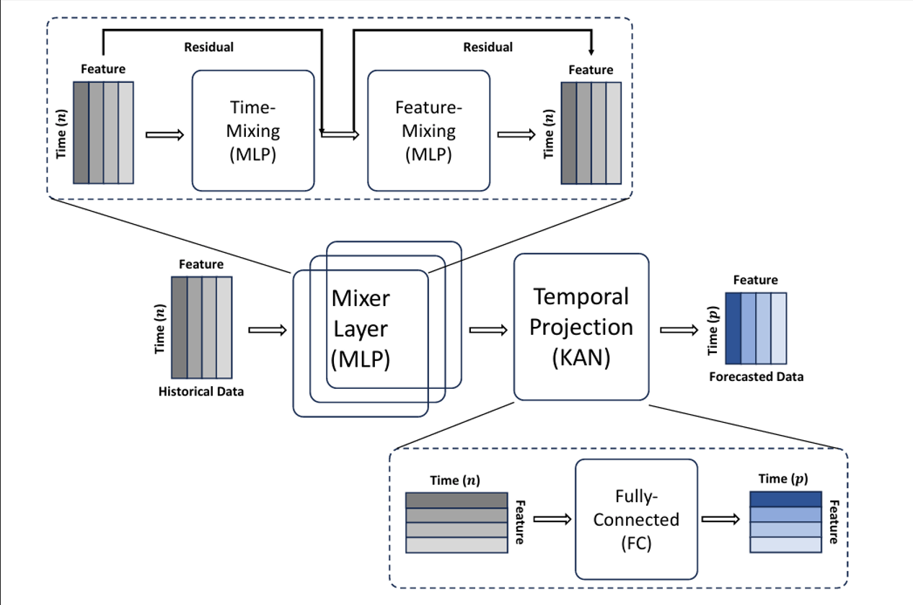
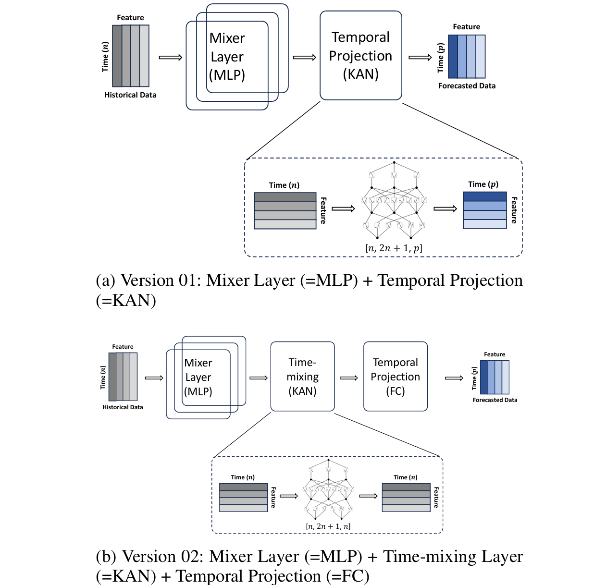
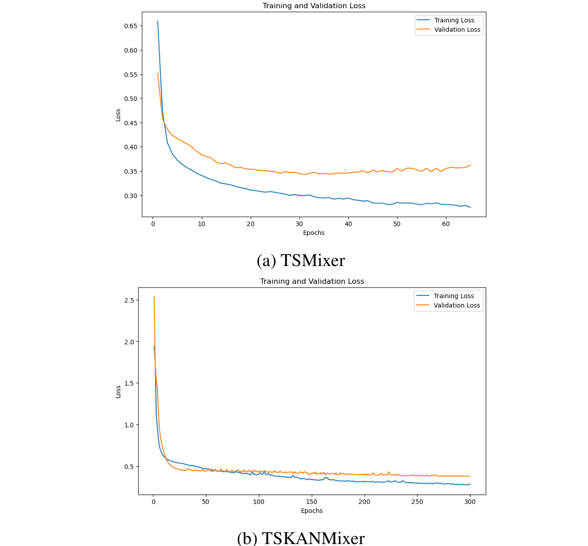

+++
date = '2026-11-09T10:00:00+08:00'
draft = false
title = '论文阅读：TSKANMixer——融合 Kolmogorov-Arnold 网络与 MLP-Mixer 的时间序列预测模型'
summary = 'AAAI 2025 TSKANMixer: Kolmogorov-Arnold Networks with MLP-Mixer Model for Time Series Forecasting 阅读笔记：将 KAN 层引入全 MLP 的 TSMixer 架构，提出两种变体，在多个时序预测基准上精度优于原始 TSMixer，代价是训练速度显著变慢。'
tags = ['论文阅读', '时间序列预测', 'KAN', 'TSMixer', '深度学习']
categories = ['论文阅读']
cover = '/images/fm5.png'
+++

> TSKANMixer: Kolmogorov–Arnold Networks with MLP-Mixer Model for Time Series Forecasting | AAAI 2025
> TSKANMixer：融合 Kolmogorov-Arnold 网络与 MLP-Mixer 的时间序列预测模型
> 
> - 原文链接：<https://arxiv.org/abs/2502.18410>
> - 原文下载：<https://arxiv.org/pdf/2502.18410>

## 一、总述

本篇论文提出 TSKANMixer 架构，主要验证了 KAN 在时序预测中的潜力。

时间序列预测一直是经济学、能源、医疗和交通管理等多个领域的研究焦点，其中理解和预测时间模式对于决策和规划至关重要。最近的工作为时间序列模型引入了创新架构，例如时间序列混合器（TSMixer），它利用多层感知机（MLP）通过有效捕获数据中的空间和时间依赖关系来提升预测精度。

> 注：时间序列预测就是根据过去的数据预测未来，比如根据过去几年的用电记录，预测未来几天的电力负荷。这篇论文中的 TSKANMixer 要解决的问题就是：给定一段历史多变量时间序列，例如长度 $L=512$ 的历史输入，预测未来 $H=96$ 个时间步的数值。

## 二、前置知识

### MLP（Multi-Layer Perceptron，多层感知机）

最基础的前馈神经网络，是一种由"全连接层 + 非线性函数"堆叠成的网络结构：

$$h = \sigma(Wx + b)$$

全连接层中，$W$ 是权重矩阵，$b$ 是偏置。假如接收一组输入数 $x_1, x_2, x_3$（事实上输入的是一个复杂矩阵），一个输出可以写成：

$$z = w_1x_1 + w_2x_2 + w_3x_3 + b$$

而 $\sigma$ 指某种非线性激活函数（仅做前面的加权求和，输入和输出之间仍是线性关系，而非线性函数可以表达更复杂的关系，使输出不再只是输入的简单比例组合，这样模型可以拟合更复杂的模式）。多个这样的层堆叠起来（反复全连接层和非线性函数），就能学习复杂的非线性映射。

### TSMixer（Time-Series Mixer，时间序列混合器）

是一个时间序列预测模型，用 MLP 分别沿时间方向和特征方向混合信息（即综合同一行或同一列中多个位置的信息，得到一个新表示），并多次交替堆叠这些 MLP 模块。每一层模块通常会配合两种操作：

1. **残差连接**：把模块输出与该模块输入相加，使模型至少保留原始信息，不被迫丢掉已有表示；
2. **归一化**：把数值尺度调整到较稳定范围（比如全部压缩到 0~1 之间），帮助训练。

经过若干混合模块后，模型仍需要把时间长度从历史长度 $L$ 变成预测长度 $H$，这一步叫**时间投影**，通常也由一个全连接层或 MLP 完成（前面提到的权重矩阵 $W$ 同样可以用来改变一个矩阵的形状（长度），完成最终映射，并输出预测值）。

### 本文思路：在 TSMixer 中加入 KAN 层

本文通过在 TSMixer 中加入 KAN 层（TSKANMixer）来研究 Kolmogorov-Arnold 网络（KAN）在时间序列预测中的能力。实验结果表明，TSKANMixer 在多个数据集上倾向于比原始 TSMixer 提升预测精度。

> 注：本文是 2025 年发表的论文，KAN 是 2024 年新提出的网络结构：MLP 是"固定激活函数在节点上，边是线性权重"；KAN 反过来——"权重在边上是可学习的样条函数，节点上只是简单求和"。本文就是把 TSMixer 里的 MLP 层换成 KAN 层。

### KAN（Kolmogorov-Arnold Network）

一种神经网络结构，它不是专门为时间序列设计的，而是作为传统 MLP（多层感知机）的一种替代或扩展。KAN 建立在 Kolmogorov-Arnold 表示定理上。这个定理大致是说：一个依赖多个输入变量的连续函数，可以写成有限个"只依赖一个输入变量的一元函数"的组合，再通过加法和外层一元函数组合起来。本文给出的形式是：

$$f(x_1, \ldots, x_n) = \sum_{j=1}^{2n+1} \Phi_j\left(\sum_{i=1}^{n} \phi_{j,i}(x_i)\right)$$

其中：

- $x_1, \ldots, x_n$ 是 $n$ 个输入数；
- $\phi_{j,i}(x_i)$ 是只依赖单个输入 $x_i$ 的函数；
- $\Phi_j$ 是外层的一元函数。

每一个输入数都有一个可学习的一元函数，得到的结果最后相加。而可学习一元函数怎么实现？论文说，KAN 用**样条**来参数化这些一元函数。

样条可以理解为用若干控制点把一条曲线分成若干段，每段用低阶多项式连接，形成一条平滑曲线。它有两个关键参数：

- **阶数 $k$**：每段多项式曲线的阶数；
- **区间数 $G$**：相邻控制点之间分成多少段。

训练时，这些样条的控制点参数是可学习的。因此 KAN 的每个边函数 $\phi_{j,i}$ 不是预先固定的，而是随着训练动态改变形状。也正因为每个一元函数需要更多参数来表示，KAN 的可学习参数数量大约是 MLP 的 $(k+G)$ 倍。这带来更强的函数拟合能力，但也增加计算量。

**论文使用两层 KAN**：

- **第一层**：输入 $n$ 个数（输入维度），输出 $2n+1$ 个中间值（隐藏层宽度）；
- **第二层**：输入 $2n+1$ 个中间值，输出 $1$ 个单输出函数。

**KAN 的优点**包括：

1. **更强的非线性函数拟合能力**：因为边上是可学习的一元函数，而不是固定线性权重；
2. **潜在的可解释性**：学到的边函数可以被观察，可能帮助理解模型学到了什么关系；
3. **在部分任务上精度更好**：论文实验中 TSKANMixer 在多个数据集上优于原始 TSMixer。

但存在很明显的**缺点**：

1. **参数更多**：每个一元函数用样条表示，参数量约为 MLP 的 $(k+G)$ 倍；
2. **训练更慢**：论文指出 KAN 通常比 MLP 慢约 10 倍，TSKANMixer 最慢时可达 TSMixer 的约 50 倍；
3. **超参数搜索更困难**：多了样条阶数、区间数、KAN 隐藏维度等参数。

因此论文没有用 KAN 完全替换 TSMixer，而是提出两种改法：

- **TSKANMixer v01**：保留 TSMixer 的混合 MLP 模块，把最后的时间投影全连接层替换成 KAN；
- **TSKANMixer v02**：保留混合 MLP 和最后的时间投影，在中间增加一个基于 KAN 的时间混合层，以增强发现时间模式的能力。

即用"边上是可学习一元函数"的 KAN 层，替代或增强 TSMixer 中原本由 MLP/全连接层承担的时间投影或时间混合功能，从而提升对复杂时间模式的建模能力。

以 TSKANMixer v01 为例：它把 TSMixer 最后的时间投影全连接层换成 KAN。它通过学习过去输入和未来预测之间的复杂关系，将时间序列从输入长度 $L$ 映射到预测长度 $H$。

在这个具体任务中，KAN 的输入维度 $n$ 对应被投影的那个维度，例如历史时间长度 $L$；输出则对应预测长度 $H$ 或目标变量维度。论文图 2 中把时间投影画成 KAN，并标注类似 $[n, 2n+1, p]$ 的结构，其中最后的 $p$ 对应实际输出维度。

> 以上为引言部分，主要是先入为主，提前了解文章要讲一个什么架构，看后面就会比较轻松。

## 三、原文引言部分

我们继续回到原文引言部分。近年来，各种基于深度学习的预测模型，包括 CNN、RNN、MLP 和 Transformer，已被广泛研究以捕获真实世界时间序列数据集中的复杂性——这些数据集通常是多变量的，且变量之间存在复杂的非线性依赖关系。

直觉普遍认为，深度学习模型应该比单变量模型更有效，然而研究表明基于 Transformer 的模型在许多常用预测基准上实际可能显著差于简单的单变量时间线性模型，因为它们存在过拟合问题。在最近一些工作中也表明，简单的单变量线性模型在几个常用学术基准上可以优于这类深度学习模型。

> 注：这是时间序列预测领域一个著名发现：Zeng 等人（2023）发现最简单的线性模型居然比 Transformer 效果还好，因为 Transformer 参数太多容易过拟合。

Chen 等人（2023）受计算机视觉中 MLP-Mixer 架构启发，提出了全 MLP 时间序列预测架构 TSMixer，通过交替堆叠多个 MLP 来捕获时域时间信息和特征域跨变量信息，证明不依赖 Transformer 也能达到最优性能。

> 注：TSMixer 就是开头说的架构。MLP-Mixer 本来是 CV 领域 Google 2021 年的工作，证明纯 MLP 在图像分类上也能打，TSMixer 把这个思路搬到时间序列。

另一方面，最近 Kolmogorov-Arnold 网络（KAN）被提出作为 MLP 的有前景的替代方案。与传统 MLP 在节点上使用固定激活函数不同，KAN 在边上使用可学习的激活函数，而在节点上仅执行简单求和。这些人将 KAN 介绍为一种强大的新神经网络架构，相比 MLP 多层感知机，它可以提高性能和可解释性。这显然为进一步改进严重依赖多层感知机的深度学习模型提供了机会。

最近的研究探索了 KAN 在时间序列中的应用。Xu 等人（2024）证明两个 KAN 模型显著优于传统预测方法。Vaca-Rubio 等人（2024）表明 KAN 在卫星流量预测中以更少参数优于 MLP。Genet 等人（2024）结合 RNN 和 KAN 提出了时间序列 KAN。这些研究证实 KAN 在真实场景中效果良好。本文受 KAN 启发，提出 TSKANMixer，研究 KAN 在 TSMixer 中的应用。

> 注：这篇论文的定位：KAN 刚出来时已有几篇用到时间序列上，但还没人把 KAN 和 TSMixer 结合过。这篇论文就是做这个"组合创新"。

## 四、Related Work（相关工作）

### Time-Series Mixer（TSMixer）

TSMixer 是一个基于 MLP 的时间序列预测架构，它分析了线性模型在时间序列预测中的性能，并在多个基准上展示了有竞争力的性能。TSMixer 由跨时间和特征维度的多个 MLP 层组成（时间混合和特征混合块），通过残差连接和批归一化交替捕获时域时间模式和特征域跨变量信息。

> 注：TSMixer 的一个 block 内部：① 时间混合 MLP——对每个特征把不同时间步混合；② 特征混合 MLP——对每个时间步把所有特征混合。交替堆叠多个 block，最后接全连接层把输入长度 $L$ 映射到预测长度 $H$。

残差设计确保 TSMixer 保留了时间线性模型的能力。与最近的基于 Transformer 的模型相比，TSMixer 的架构相对简单易实现。尽管简单，TSMixer 在代表性基准上仍然与最优模型保持竞争力。TSMixer 架构细节如图 1 所示。

*图 1：TSMixer 多变量时间序列预测架构*

这张图最外层：

**Historical Data（历史数据）**（纵向是时间，长度 $n$；横向是特征/变量）→ **Mixer Layer (MLP)**（混合层，每个混合层内部由 MLP 构成，负责在时间方向和特征方向上混合信息）→ **Temporal Projection（时间投影）**（时间长度从历史长度 $n$ 变成预测长度 $p$）→ **Forecasted Data（预测数据）**

上方虚线框：Mixer Layer 内部（包含两个子模块）：

1. **Time-Mixing (MLP)**：时间混合。这个 MLP 沿时间方向处理：对同一个特征，把不同历史时间步的值进行加权组合；目的是学习时间上的依赖关系，例如趋势、滞后、周期性等。
2. **Feature-Mixing (MLP)**：特征混合。对同一个时间步，把不同变量的值进行加权组合；目的是学习变量之间的跨特征依赖关系。
3. **Residual（残差连接）**：图中上方有箭头绕过模块，标着 Residual，意思是把模块的输入直接加到模块输出上。这样做的好处是模型可以保留原始信息，不会因为经过 MLP 而丢失已有表示；同时 MLP 只需要学习"在原始信息基础上需要修正什么"。

下方虚线框：Temporal Projection 内部：

时间长度为 $n$ 的矩阵，通过 Fully-Connected (FC)，即全连接层，输出时间长度为 $p$ 的矩阵。全连接层：前面提到，通过矩阵 $W$ 和偏置 $b$，对输入矩阵进行长度变换。

### Kolmogorov-Arnold Network（KAN）

MLP 的理论依据之一是万能逼近定理（一个具有单隐藏层的神经网络，只要隐藏层神经元足够多，就可以在有限区域内逼近任何连续函数）；而 KAN 基于 Kolmogorov-Arnold 表示定理，该定理指出，有界域上的任何多元连续函数 $f(x)$ 都可以表示为单变量连续函数的有限叠加与加法运算。形式化地：

$$f(x) = \sum_{j=1}^{2n+1} \Phi_j\left(\sum_{i=1}^{n} \phi_{j,i}(x_i)\right)$$

其中 $\Phi_j$ 是外层函数，$\phi_{j,i}$ 是内层函数。

MLP 的每一层执行线性变换后跟一个非线性激活函数；类似地，KAN 层可以定义为一个单变量函数矩阵 $\Phi$：

$$\Phi(x) = \{\phi_{j,i}\},\quad i = \{1, \ldots, n_{in}\},\quad j = \{1, \ldots, n_{out}\}$$

其中单变量函数 $\phi_{j,i}$ 具有可训练参数。一般来说，KAN 可以表示为多个 KAN 层的组合。Kolmogorov-Arnold 表示定理可以用形状为 $[n, 2n+1, 1]$ 的两层 KAN 层来表示。

MLP 在节点上使用固定激活函数，而 KAN 在边上使用可学习激活函数。具体来说，KAN 通过用参数化为样条函数的单变量函数替换 MLP 上的传统线性权重来动态学习激活模式。样条由阶数 $k$（控制点之间插值曲线所用多项式的次数）和间隔数 $G$（相邻控制点之间的段数）定义。在样条插值过程中，由 $G$ 个间隔分隔的控制点被连接成一条光滑曲线。

通过可学习激活函数，KAN 在更紧凑的架构下提升了精度和可解释性。Vaca-Rubio 等人（2024）证明 KAN 在时间序列预测中始终以更低的误差指标优于 MLP。然而，由于其内在架构，KAN 比 MLP 多 $(k+G)$ 倍的可学习参数。为提升计算效率，几种正则化技术在优化 KAN 训练方面已被证明是有效的（Cheon 2024），具体而言，dropout、权重衰减和批归一化不仅加速收敛，还显著改善了泛化能力。此外，贝叶斯优化可用于减少参数搜索空间。

> 注：这里只是前置的 KAN 的内容，不是本篇论文讲述的 TSKANMixer 架构。

## 五、TSKANMixer Architecture（TSKANMixer 架构）

本文探索并评估将 KAN 层应用于基于 MLP 的 TSMixer 架构，提出两种 TSKANMixer 架构，如图 2 所示。所提模型应用 KAN 框架来学习时间数据中复杂的非线性关系。

*图 2：TSKANMixer 架构*

### (a) Version 01：用 KAN 替换最后的投影层

核心目的：仅仅用 KAN 强化最终从"历史"到"未来"的非线性映射能力。

数据流向：

历史数据 → Mixer Layer (MLP) → Temporal Projection (KAN) → 预测输出

原本 TSMixer 在最后一步会用全连接层（FC）把时间长度从 $n$ 映射到 $p$。在这个版本里，把这个全连接层换成了 KAN：

- **左侧输入**：时间长度为 $n$ 的矩阵。
- **中间结构**：一个两层 KAN，结构标注为 $[n, 2n+1, p]$。第一层输入 $n$，输出 $2n+1$（对应之前讲的定理中的隐藏层宽度）；第二层输入 $2n+1$，输出 $p$，这里的 $p$ 就是我们要预测的未来时间长度。
- **右侧输出**：时间长度为 $p$ 的矩阵。

### (b) Version 02：在中间增加 KAN 时间混合层

保留原本的投影方式，但在提取特征的阶段，利用 KAN 更强的非线性表达能力，把历史时间步里的模式挖得更深。

数据流向：

历史数据 → Mixer Layer (MLP) → Time-mixing (KAN) → Temporal Projection (FC，全连接层) → 预测输出

新增的 KAN 内部：

- **左侧输入**：时间长度为 $n$。
- **中间结构**：一个两层 KAN，结构标注为 $[n, 2n+1, n]$。这里的输出仍然是 $n$，这意味着这个模块不改变时间长度，它的作用只是在这 $n$ 个时间步内部，通过 KAN 进一步深度混合信息，挖掘更复杂的时间依赖。
- **右侧输出**：时间长度依然为 $n$。

## 六、Experiment（实验）

本节评估所提两种 TSKANMixer 架构（图 2a 和图 2b）的预测性能。作者在常用的多变量时间序列基准数据集上评估，这些数据集没有缺失值且所有序列等长：电力变压器温度（ETT）长期预测数据集、NN5 预测竞赛数据集、CIF 2016 预测竞赛数据集、FRED-MD 数据集、Exchange 数据集和 Hospital 数据集。

电力变压器温度是电力长期部署中的关键指标。该数据集包含来自中国两个不同县的两年数据。每个数据集包含目标变量"油温"（OT）和六个电力负荷特征。NN5 数据集包含英国 ATM 每日取款额的 111 条时间序列。CIF 2016 包含 72 条月度时间序列，其中 24 条来自银行业，48 条为人工生成；本文只使用 48 条等长序列。Hospital 数据集收集了 2000 年 1 月至 2006 年 12 月与医疗产品相关的 767 条月度患者计数时间序列。Exchange 数据集收集了 1990 年至 2016 年八个国家（澳大利亚、英国、加拿大、瑞士、中国、日本、新西兰、新加坡）的日汇率。FRED-MD 数据集包含美联储的 107 条月度宏观经济指标时间序列。

#### 补充：零均值标准化（Zero-Mean Normalization）

每个数据集都做了零均值标准化，以确保与 TSMixer 公平比较。零均值标准化主要把数据的中心平移到 0，并把数据的尺度缩放为 1。

假设某一个变量有一组历史数据：$x_1, x_2, \ldots, x_m$。

第一步，计算这组数据的平均值（$\mu$）和标准差（$\sigma$，代表数据的波动幅度）。

第二步，对每一个数据 $x_i$ 套用公式：

$$x'_i = \frac{x_i - \mu}{\sigma}$$

除以标准差 → 数据的波动幅度被压缩或拉伸，使得新数据的标准差变为 1。

时间序列数据往往包含多个变量，不同变量的单位不同、值范围差距较大，如果直接把原始数据输入模型，模型在做加权求和时，数值大的变量会完全掩盖数值小的变量的影响。经过零均值标准化后，所有变量都被缩放到差不多的大小，模型就能公平地学习每个变量的规律。

基准数据集的统计信息和数据划分如表 1 所示。

**表 1：Time Series Forecasting Datasets**

| dataset | features | time steps | time granularity | data split (train/valid/test) |
| --- | --- | --- | --- | --- |
| ETTh1/h2 | 7 | 17,420 | 1 hour | 12/4/4 month |
| ETTm1/m2 | 7 | 699,680 | 15 min | 12/4/4 month |
| NN5 daily | 111 | 791 | 1 day | 672/59/59 |
| NN5 weekly | 111 | 113 | 1 month | 96/8/8 |
| CIF 2016 | 48 | 120 | 1 month | 96/12/12 |
| Hospital | 767 | 84 | 1 month | 58/12/12 |
| Exchange | 8 | 7,588 | 1 day | 6829/379/379 |
| FRED MD | 107 | 728 | 1 month | 698/14/14 |

字段说明：

- **features（特征数量 / 变量数量）**：指在这个数据集中，每个时间步记录了多少个不同的指标（列数）。比如 ETTh1/h2 是 7，意味着每个时间步记录了 7 个指标（比如油温、6 种电力负荷）；Hospital 高达 767，说明这是一个变量非常多的数据集。
- **time steps（时间步总数 / 总长度）**：指整个数据集在时间轴上有多少条记录（行数）。ETTm1/m2 高达 699,680，因为它是 15 分钟记录一次，记录了好几年，数据量极大。
- **time granularity（时间粒度）**：指相邻两条数据之间相隔多久，也就是采样频率。
- **data split (train/valid/test)（数据划分：训练集/验证集/测试集）**：时间序列数据不能随机打乱划分，必须按照时间先后顺序，把过去的数据用来训练，中间的数据用来验证，未来的数据用来测试。对于 ETT 数据集按照月份划分，比如 12/4/4 month 表示用前 12 个月的数据训练，接着 4 个月验证，最后 4 个月测试。

### Experimental Setup（实验设置）

作者专注于通过与原始架构对比来评估 KAN 层对 TSMixer 的影响，因此，在 ETT 数据集的数据划分和超参数方面遵循 TSMixer 论文的实验设置。输入长度 $L=512$，预测视野 $H=96$。

> 注：时间序列往往长达几千甚至几十万步，而模型一次只能吃进 512 步。那怎么训练呢？用的是滑动窗口的方法：把第 1 步到第 512 步作为输入（$L$），把紧挨着的第 513 步到第 608 步作为标准答案（$H$），让模型去学；把第 2 步到第 513 步作为输入，把第 514 步到第 609 步作为标准答案……以此类推，不断向后平移这个长度为 512 的"窗口"，模型就能学会时间序列里的演变规律。

作为基准比较，实验选择了各种最先进的时间序列模型：基于 MLP 的 SOFTS、基于 MLP 的 TimeMixer、基于 GNN 的 StemGNN、基于 Transformer 的 Informer，以及简单 MLP。所有模型在每个数据集上使用与 TSMixer 相同的预测长度（$H$）和输入长度（$L$）。通过计算均方误差（MSE，"预测值减去真实值"的平方求平均）和平均绝对误差（MAE，"预测值减去真实值"的绝对值求平均）作为评估指标。最小化 MSE 或 MAE 作为损失函数。所有模型在单张 NVIDIA T4 GPU（16GB 显存）的 ml.g4dn.xlarge 实例上训练和测试。TSMixer 做网格搜索，TSKANMixer 因为训练成本高，只做有限的手动探索。

#### 补充：网格搜索（Grid Search）

在训练模型之前，我们需要人为设定一些超参数。比如：

- 模型要学得多快？（学习率）
- 一次看多少条数据？（批次大小 Batch size）
- 内部网络有几层？（Mixer blocks 数量）
- 为了防止死记硬背，每次故意丢弃多少信息？（Dropout 率）

网格搜索就是用来"找最佳参数组合"的一种穷举法，它会像建一个三维网格一样，把所有的组合都试一遍，然后看哪一个组合在验证集上跑出的误差（比如 MSE）最小，最后就定下用这一组参数。

### Experimental Results（实验结果）

表 2 总结了 8 个时间序列预测模型在 10 个数据集上的 MSE 和 MAE 综合比较。每个数据集的前三名结果以粗体标出，最佳结果以下划线标出。

**表 2：Evaluation results on the public time-series datasets**

| dataset | $L$ | $H$ | v01 MSE (∆%) | v01 MAE (∆%) | v02 MSE (∆%) | v02 MAE (∆%) | TSMixer MSE | TSMixer MAE | SOFTS MSE | SOFTS MAE | TimeMixer MSE | TimeMixer MAE | MLP MSE | MLP MAE | StemGNN MSE | StemGNN MAE | Informer MSE | Informer MAE |
| --- | --- | --- | --- | --- | --- | --- | --- | --- | --- | --- | --- | --- | --- | --- | --- | --- | --- | --- |
| ETTh1 | 512 | 96 | 0.285 (33.57%) | 0.398 (2.69%) | 0.296 (31.00%) | 0.405 (0.98%) | 0.429 | 0.409 | 0.609 | 0.441 | 0.516 | 0.415 | 0.517 | 0.595 | - | - | 0.337 | 0.403 |
| ETTh2 | 512 | 96 | 0.199 (-2.05%) | 0.334 (1.76%) | 0.158 (18.97%) | 0.308 (9.41%) | 0.195 | 0.340 | 0.135 | 0.277 | 0.593 | 0.552 | 0.418 | 0.529 | - | - | 0.208 | 0.373 |
| ETTm1 | 512 | 96 | 0.190 (34.26%) | 0.296 (13.20%) | 0.281 (2.77%) | 0.348 (-2.05%) | 0.289 | 0.341 | 0.211 | 0.307 | 0.271 | 0.355 | 0.406 | 0.378 | - | - | 0.259 | 0.377 |
| ETTm2 | 512 | 96 | 0.131 (9.66%) | 0.268 (3.60%) | 0.109 (24.83%) | 0.251 (9.71%) | 0.145 | 0.278 | 0.148 | 0.279 | 0.108 | 0.245 | 0.240 | 0.398 | - | - | 0.215 | 0.362 |
| NN5 daily | 56 | 56 | 0.521 (-1.36%) | 0.498 (-1.01%) | 0.506 (1.56%) | 0.485 (1.62%) | 0.514 | 0.493 | 0.545 | 0.506 | 0.627 | 0.582 | 0.641 | 0.582 | 0.561 | 0.515 | 0.544 | 0.521 |
| NN5 weekly | 16 | 8 | 0.878 (2.34%) | 0.731 (1.08%) | 0.897 (0.22%) | 0.736 (0.41%) | 0.899 | 0.739 | 0.938 | 0.771 | 0.901 | 0.736 | 1.195 | 0.883 | 1.758 | 1.014 | 1.177 | 0.859 |
| CIF 2016 | 24 | 12 | 3.631 (-34.58%) | 1.026 (-31.37%) | 2.936 (-8.82%) | 0.895 (-14.59%) | 2.698 | 0.781 | 2.585 | 0.687 | 3.736 | 0.934 | 4.963 | 1.241 | 2.475 | 0.760 | 5.275 | 1.385 |
| Hospital | 24 | 12 | 1.429 (11.08%) | 0.928 (6.64%) | 1.556 (3.17%) | 0.979 (1.51%) | 1.607 | 0.994 | 1.338 | 0.875 | 1.525 | 0.939 | 1.454 | 0.939 | 1.475 | 0.929 | 1.784 | 1.031 |
| Exchange | 60 | 30 | 0.017 (5.56%) | 0.099 (7.47%) | 0.016 (11.11%) | 0.094 (12.15%) | 0.018 | 0.107 | 0.011 | 0.084 | 0.025 | 0.115 | 0.139 | 0.295 | 1.802 | 1.060 | 0.015 | 0.088 |
| FRED MD | 48 | 12 | 0.037 (-5.71%) | 0.133 (-6.4%) | 0.036 (-2.86%) | 0.125 (0%) | 0.035 | 0.125 | 0.052 | 0.122 | 0.046 | 0.126 | 0.126 | 0.255 | 0.101 | 0.202 | 0.049 | 0.145 |

> 注：∆% 表示 TSKANMixer 相对原始 TSMixer 的误差改进幅度，正值表示误差降低，负值表示误差升高；"-"表示 StemGNN 在 ETT 数据集上因显存溢出（OOM）未报告结果。论文原表将每个数据集的前三名以粗体标出、最佳结果以下划线标出，本表从略。

对实验结果的解读：

1. **KAN 确实有效**：TSKANMixer 相比原版 TSMixer，在多数数据集上显著降低了误差（如 ETTm1 的 MSE 降低了 34.26%）。
2. **两版本各有胜负**：v01（替换投影层）与 v02（增加时间混合层）表现相当，在不同数据集上互有输赢，没有绝对优劣。
3. **稳居第一梯队**：没有任何时间序列预测模型在所有数据集上占优，但 TSKANMixer 在 10 个数据集中各有 7 次进入前三名，整体极具竞争力。
4. **极端特例存在**：StemGNN 因显存溢出（OOM）在 ETT 数据集上无法跑出结果；CIF 2016 数据集对多数模型极不友好，唯独 StemGNN 表现较好，这可能意味着该数据集具有不同的时间序列特性，当前 TSKANMixer 和 TSMixer 的变体未能捕捉到。
5. **MSE 与 MAE 排名偶有分歧**：因 MSE 放大极端误差，MAE 反映平均偏差，导致某些模型在两项指标上的排名不完全一致（如 ETTm1 中 v01 的 MSE 最优但 MAE 不敌 SOFTS）。

由于加入了 KAN 层，TSKANMixer 的训练时间明显比 TSMixer 慢，因为 KAN 引入了额外的复杂性和计算量。研究报告称，相同参数量下 KAN 通常比 MLP 慢 10 倍。训练限制制约了 TSKANMixer 在更大数据集上的测试，并阻碍了本文中广泛的超参数调优。此外，TSKANMixer 在 ETT 数据集上有时需要比 TSMixer 更多的轮次才能完成训练。结果如表 3 所示，TSKANMixer 的训练时间有时约为原始 TSMixer 的 50 倍。

**表 3：Computational Time**

| dataset | $L$ | $H$ | v01 time/epoch (sec) | v01 training time (sec) | v02 time/epoch (sec) | v02 training time (sec) | TSMixer time/epoch (sec) | TSMixer training time (sec) |
| --- | --- | --- | --- | --- | --- | --- | --- | --- |
| ETTh1 | 512 | 96 | 21.29 | 4885.08 | 63.70 | 11869.71 | 4.10 | 263.01 |
| ETTh2 | 512 | 96 | 40.69 | 12276.67 | 63.59 | 19302.69 | 4.74 | 312.52 |
| ETTm1 | 512 | 96 | 88.81 | 11662.25 | 264.63 | 39819.87 | 26.83 | 1282.46 |
| ETTm2 | 512 | 96 | 171.43 | 19242.63 | 263.53 | 63953.10 | 27.26 | 2032.07 |
| NN5 daily | 56 | 56 | 25.82 | 1884.76 | 22.80 | 1869.92 | 0.62 | 135.86 |
| NN5 weekly | 16 | 8 | 6.19 | 1354.61 | 3.21 | 125.01 | 0.08 | 28.89 |
| CIF 2016 | 24 | 12 | 2.97 | 204.98 | 4.03 | 454.99 | 0.07 | 59.96 |
| Hospital | 24 | 12 | 20.32 | 589.23 | 15.09 | 2489.44 | 0.04 | 11.9 |
| Exchange | 60 | 30 | 5.04 | 181.33 | 9.70 | 339.55 | 10.18 | 2421.82 |
| FRED MD | 48 | 12 | 30.89 | 1730.17 | 19.98 | 3036.34 | 0.33 | 181.19 |

为说明缓慢的训练过程，我们可视化了 TSMixer 和 TSKANMixer 在训练轮次上的训练和验证损失，如图 3 所示。

*图 3：ETTh2 上训练轮次对应的训练与验证损失*

在 ETT 数据集上，TSMixer 初始损失值相对 TSKANMixer 较低。它在较早阶段（如不到 50 轮）就达到最佳轮次，然后开始过拟合——表现为验证损失随轮次增加而上升，训练损失和验证损失出现分歧（图 3a）。另一方面，TSKANMixer 初始损失值较差，但验证损失随轮次增加稳步下降，不会快速过拟合（如最佳轮次发生在 50 轮之后），如图 3b 所示。TSKANMixer 有效地捕获了数据中潜在的泛化模式，而非陷入局部最优。

## 七、Conclusion and Future Work（结论与未来工作）

**结论**：

1. **核心成果**：将 KAN 引入 TSMixer，提出了两种变体（替换投影层或增加时间混合层）。实验证明，TSKANMixer 总体上比原版 TSMixer 预测更准。
2. **代价与意义**：虽然精度提升了，但 KAN 层导致训练速度变慢。这项工作证明了 KAN 在时间序列分析中极具潜力。

**未来工作**：

1. **探索更复杂的结构并提速**：目前的 KAN 只有两层，未来要探索更宽、更深的 KAN，并想办法解决训练时间过长的问题。
2. **优化实现以便调参**：开发更高效的 KAN 底层代码，以便能跑得起全面的网格搜索（超参数调优），可能释放其全部潜力。
3. **挖掘可解释性**：利用符号回归技术（其"学出来的函数看得懂"的潜力），打造更高效的时间序列模型。
