+++
date = '2026-11-11T10:00:00+08:00'
draft = false
title = '使用篡改猴配置脚本'
summary = '以深大期中教学评价为例，介绍篡改猴（Tampermonkey）的完整使用流程：安装扩展、从 GreasyFork 与 GitHub 获取脚本、导入配置，以及脚本的最终使用，并附安装失败时的替代路径。'
tags = ['教程', '随笔', '脚本']
categories = ['教程']
cover = '/images/fm6.png'
disableImageHoverZoom = true
+++

## 前言
近期深大开展期中教学评价，便想写一篇教程来介绍篡改猴脚本的安装与使用，本篇正好以教评工具为例。

## 使用工具
- 浏览器：Microsoft Edge
- 加速器：Watt Toolkit（原 Steam++）

## 流程

### 1. 管理扩展

**点击浏览器右上角的`设置及其他`，在`扩展`中点击`管理扩展`。**

### 2. 获取扩展

**页面左边点击`获取Microsoft Edge扩展`（顺手打开左下角的开发人员模式）**

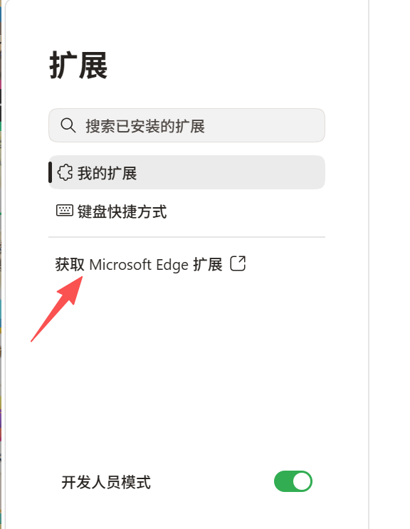

**搜索`篡改猴`并点击`获取`，这样就算安装好了。**

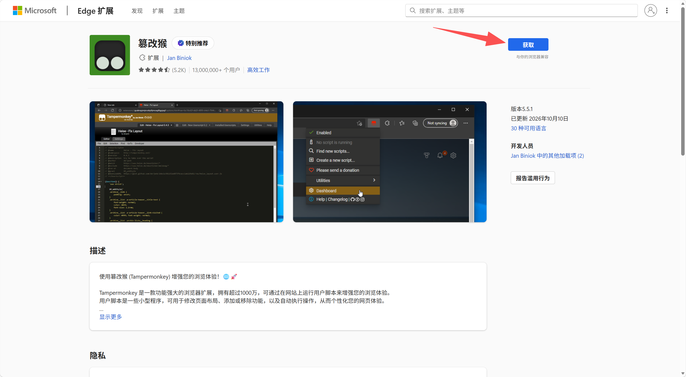

### 3. 使用篡改猴

**回到扩展页面，在已安装的扩展中点击右边开关，打开篡改猴的使用。（说句题外话，右上角有一个`加载解压缩的扩展`，使用这个也可以直接导入扩展项目文件夹）**

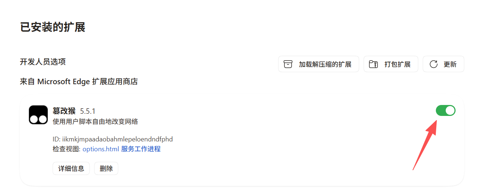

**在工具栏中点击扩展的图标，就可以看到篡改猴，右键后点击`获取新脚本`，就可以进入篡改猴的主页。**

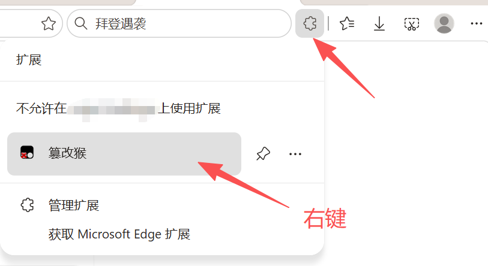

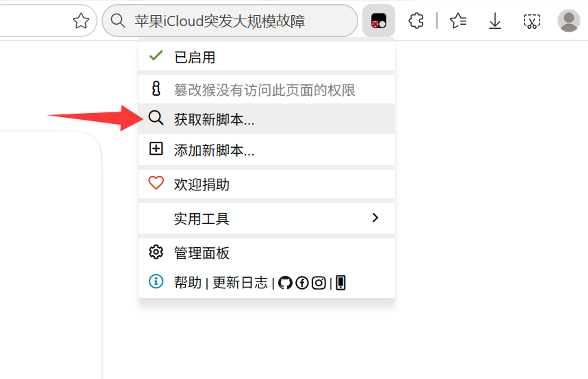

**在`用户脚本`中点击`GreasyFork`，即油叉，其中有大量的脚本资源。**

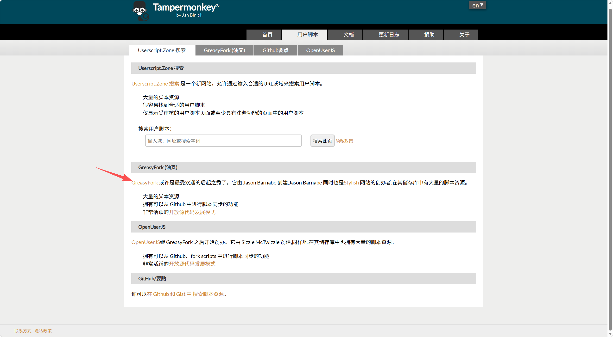

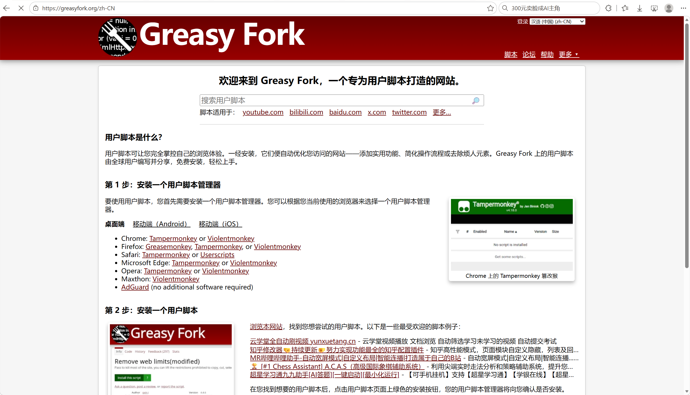

**我们搜索“szu”，就能看到很多学长学姐留下的实用工具，其中就有这个`SZU一键全自动评教助手`。**

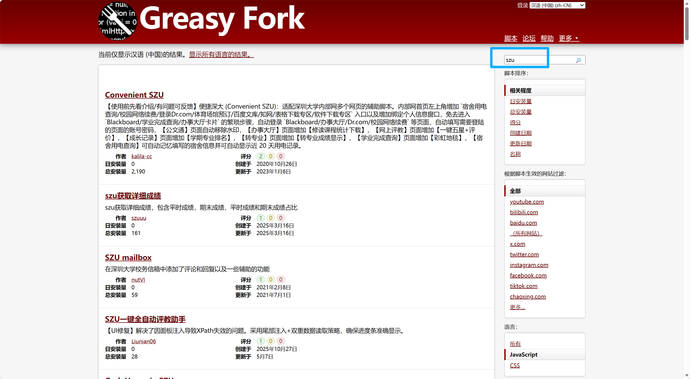

**点击`安装此脚本`，就能够进入安装页面，再次点击`安装`，就能够直接使用了。**

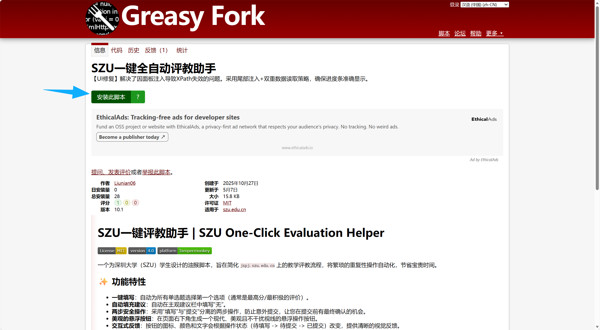

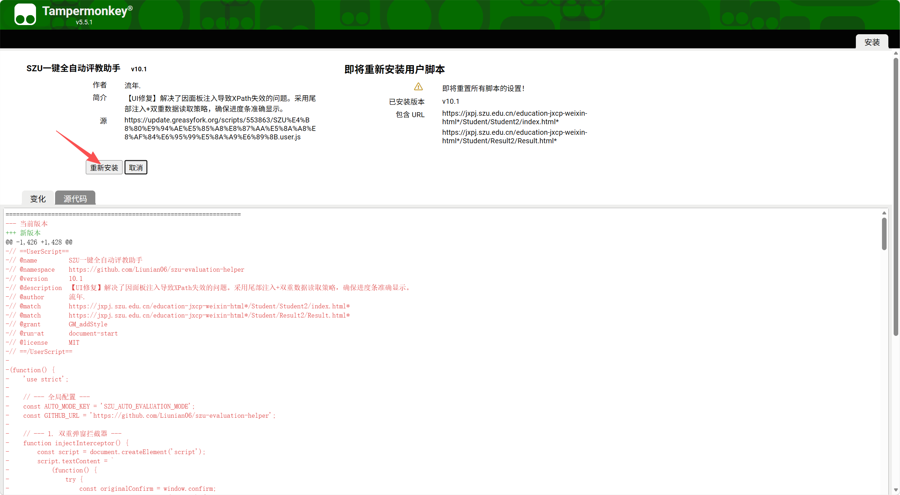

> 以前使用 Watt Toolkit 加速器就能正常访问和安装脚本，应该是直连的 GitHub。但是 GreasyFork 最近不知道怎么了，现在使用加速器也不能成功安装，暂时只能科学上网才可以安装脚本。没有条件的同学可以尝试下面路径。

### 4. 获取并配置脚本

**可以考虑在 [GitHub](https://github.com/) 中获取脚本。**

**在打开之前，因为 GitHub 经常不太稳定，所以需要安装一个加速器或者使用别的办法。`Watt Toolkit` 可以直接在电脑的应用商店（Microsoft Store）中下载，比较方便，而且免费，也没有法律风险，点击即用。**

**然后我们进入 [GitHub](https://github.com/)，并在上方搜索栏中搜索刚刚的工具的名字。**

**SZU一键全自动评教助手直达：<https://github.com/Liunian06/szu-evaluation-helper>**

**脚本的逻辑主要是图中的`szu-evaluation-helper.js`文件。（喜欢的话可以右上角点个 star）**

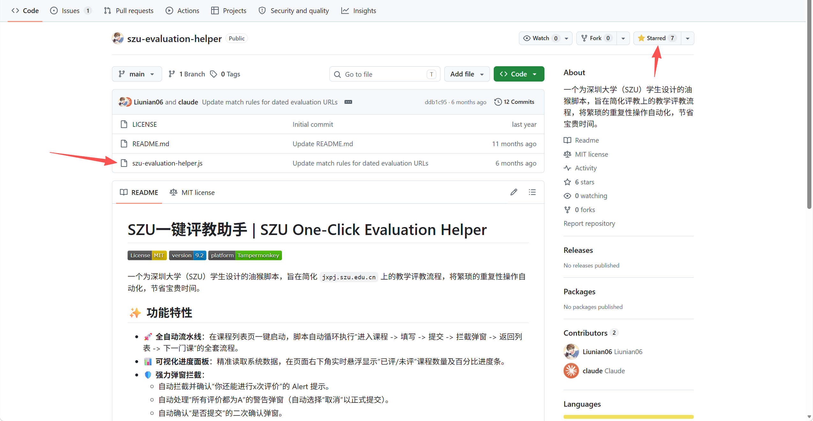

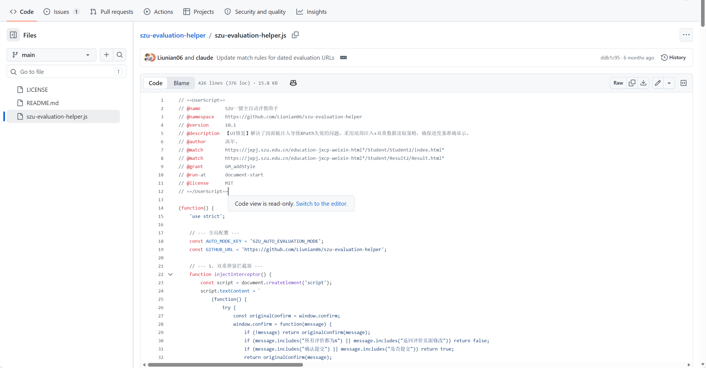

**可以把这个文件下载到本地，也可以按 `Ctrl + A` 全选后复制下来。**

**再次点击扩展图标，点击`添加新脚本`。在这里我们可以导入脚本，也可以自己直接创建脚本。**

**方法一：点击右上角的 `+` 号添加新脚本，将刚刚复制的代码粘贴进去，并按 `Ctrl + S` 保存（或者编辑区左上角`文件` → `保存`）。**

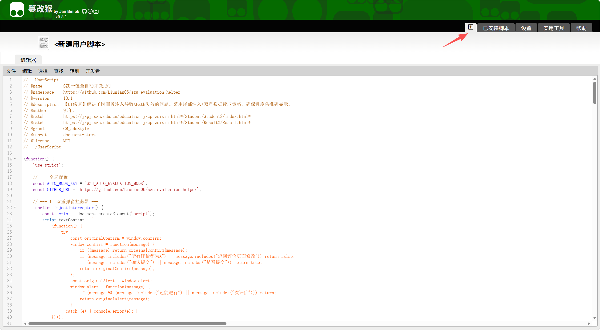

**方法二：点击右上角的`实用工具`，在导入区域点击`选择文件`，导入刚刚下载下来的 js 文件。**

**然后点击`已安装脚本`，就可以看到配置好的工具了。**

### 5. 脚本的使用

**该脚本需要在`本科课堂教学评价（移动端）`中使用。**

**进入页面后即刻启动自动教评工具。（需要开启允许在 jxpj.szu.edu.cn 使用扩展）**

> 这个教评工具的版本已经过时了，只能处理选择题，今年新添加了一种滑动条，并且每次点击评教后需要过 10s 才能提交。已经通知脚本的作者了，期待新版本（）